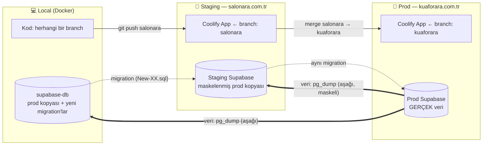

# Deployment & Alignment — Kod, Şema ve Veri Akışı

> **Amaç:** Prod'da gerçek müşteri verisi varken (randevular, kullanıcılar, ödemeler) geliştirmeyi güvenle canlıya almak ve gerektiğinde prod verisini local'e indirip ortamları hizalamak (alignment).
>
> **Son güncelleme:** 2026-10-26 · **Durum:** Analiz + hedef süreç. Uygulanacak adımlar en alttaki "Uygulama Planı" bölümünde.
>
> İlgili: [coolify-deployment.md](coolify-deployment.md) (ilk kurulum), [migrations.md](migrations.md), [rls.md](rls.md), [`scripts/prod-pull-db.sh`](../../scripts/prod-pull-db.sh)

---

## 1. Temel İlke — Üç Şey, Üç Farklı Yön

Sistemde 3 farklı "şey" var ve her birinin akış yönü farklı. Bütün süreç bu tabloya dayanır:

| Ne | Nerede yaşar | Akış yönü | Nasıl taşınır |
|----|--------------|-----------|---------------|
| **Kod** (Next.js) | Git | local → staging → prod | `git push` + merge → Coolify otomatik build |
| **Şema** (tablo, kolon, RLS, GRANT, trigger, fonksiyon, view) | Git'teki `initdb/New-XX-*.sql` | local → staging → prod | **Sadece migration script'i** — sıralı, bir kez, transaction içinde |
| **Veri** (müşteri, randevu, salon, ödeme, görseller) | Prod DB + Storage | prod → staging / local | `pg_dump` (aşağı yönlü) + Storage API |

**Altın kurallar:**
1. **Veri asla yukarı gitmez.** Local'deki DB'yi prod'a basmak = prod'daki son randevuları/kayıtları silmek. Yasak.
2. **Şema asla dump ile gitmez.** Prod'a şema değişikliği yalnızca migration dosyasıyla gider. "Bendeki son hali at" yöntemi yoktur.
3. **Kod stateless'tır.** Kodun son hali her zaman Git'tedir. İstediğin kadar at, geri al, sorun olmaz.
4. **DB stateful'dur.** Prod DB'nin "son hali" sadece prod'dadır. Ona sadece *ekleme/değiştirme talimatı* (migration) gönderilir, *kopya* gönderilmez.

> Senin sezgin doğru: "Bendeki script = DB değişiklikleri" modeli. Kodla birlikte commit edilen migration'lar prod verisine dokunmadan şemayı günceller.

---

## 2. Ortamlar ve Branch Modeli



| Ortam | Domain | Git branch | Coolify App | Supabase | Veri |
|-------|--------|-----------|-------------|----------|------|
| Local | `localhost:3000` | çalıştığın branch | — | Docker `supabase-db` | Prod'dan çekilen kopya |
| Staging | `salonara.com.tr` | **`salonara`** | Ayrı Application | Ayrı Supabase stack | Prod'dan çekilen maskeli kopya |
| Prod | `kuaforara.com.tr` | **`kuaforara`** | Ayrı Application | Ayrı Supabase stack | Gerçek |

**Durum tespiti (2026-10-26):**
- `origin/salonara` var. **`kuaforara` branch'i henüz yok.** `salonara`'dan oluşturulmalı: `git push origin salonara:kuaforara`.
- Eski [coolify-deployment.md](coolify-deployment.md) prod'u `main` branch'ine bağlıyor. Hedef modelde prod = `kuaforara`. Coolify prod Application'ında branch `kuaforara` yapılmalı.
- `main` / `master`: ya emekliye ayrılır ya da `kuaforara`'nın aynası tutulur. İki ayrı "prod" branch'i olmamalı.
- GitHub'da `kuaforara` branch'i **protected** yapılmalı: doğrudan push kapalı, sadece `salonara`'dan merge.

**Neden staging şart?** Migration'ın prod'da ilk kez çalıştığı an, hatanın ilk görüldüğü an olmamalı. Staging, prod'la aynı şema + gerçekçi veriyle "prova" ortamıdır.

---

## 3. Release Akışı (Her Geliştirmede)

Kritik nokta şu: **kod deploy'u ile migration aynı anda olamaz.** Coolify yeni container'ı ayağa kaldırırken birkaç saniye eski kod çalışır. Bu yüzden:

> **Migration ÖNCE çalışır, kod SONRA deploy olur. Her migration, o an çalışan *eski* kodu kırmayacak şekilde yazılır.** (Geriye uyumluluk / "expand-contract")

### Adım adım

```
① LOCAL — geliştir
   • Kodu yaz
   • DB değişikliği gerekiyorsa: initdb/New-XX-Aciklama.sql yaz
   • npm run db:migrate          → local'e uygula (runner, bkz. §5)
   • Test et → kod + SQL + docs AYNI commit'te
   • git push origin salonara

② STAGING — prova (otomatik/yarı otomatik)
   • Migration runner staging DB'ye bekleyen New-XX'leri uygular
   • Coolify salonara branch'ini build eder → salonara.com.tr
   • Smoke test: login, randevu akışı, owner paneli, değişen özellik
   • db-health-check.sql staging'de → 0 bulgu

③ PROD — canlıya alma
   • PROD YEDEĞİ AL (pg_dump, otomatik — runner bunu zorunlu yapar)
   • Migration runner prod DB'ye aynı New-XX'leri uygular
   • db-health-check.sql prod'da → 0 bulgu
   • GitHub: salonara → kuaforara merge (PR)
   • Coolify kuaforara'yı build eder → kuaforara.com.tr
   • Smoke test (5 dk)
```

**Neden prod migration'ı merge'den önce?** Yeni kod yeni kolonu arıyorsa ve kolon yoksa site çöker. Eski kod ise yeni (fazladan) kolonu görmezden gelir, çökmez. Yani "önce şema, sonra kod" her zaman güvenli tarafta kalır.

---

## 4. Migration Yazım Kuralları (Prod Verisini Korumak İçin)

### 4.1 Zorunlu özellikler

| Kural | Neden | Nasıl |
|-------|-------|-------|
| **Forward-only** | Prod'da "geri sar" yok, sadece "ileri düzelt" var | Hata olursa yeni bir `New-XX+1` ile düzelt |
| **Idempotent** | Yanlışlıkla 2 kez çalışırsa bozmasın | `IF NOT EXISTS`, `DROP POLICY IF EXISTS` + `CREATE`, `ON CONFLICT DO NOTHING` |
| **Transaction içinde** | Yarıda kalırsa DB yarım şema ile kalmasın | Runner `--single-transaction` ile çalıştırır |
| **Geriye uyumlu** | Eski kod çalışmaya devam etsin (§3) | Expand-contract (aşağıda) |
| **Kendini kaydeder** | Hangi ortamda neyin uygulandığı bilinsin | Runner `_migrations`'a yazar — dosyaya elle `INSERT` yazmaya gerek kalmaz |
| **Benzersiz numara** | Sıra belirsizliği olmasın | Runner aynı numarayı iki kez görürse durur |
| **RLS + GRANT birlikte** | CLAUDE.md kuralı — "permission denied" / boş `{}` hatası | Yeni tablo checklist'i (CLAUDE.md) |
| **Veri silmez** | Müşteri verisi geri getirilemez | `DELETE`/`DROP`/`TRUNCATE` → CLAUDE.md onay protokolü |

### 4.2 Değişiklik türüne göre reçeteler

| Ne değişiyor | Güvenli yol | Tehlikeli yol (yapma) |
|--------------|-------------|------------------------|
| **Yeni kolon** | `ADD COLUMN IF NOT EXISTS x text` (nullable veya `DEFAULT`'lu). PG15'te anında olur, kilit yok | `NOT NULL` + default'suz → mevcut satırlarda patlar |
| **Kolon yeniden adlandırma** | 3 release: ① yeni kolon ekle + backfill + trigger ile iki yönlü kopyala ② kod yeni kolonu kullansın ③ eski kolonu sil | Tek adımda `RENAME COLUMN` → çalışan eski kod anında kırılır |
| **Kolon silme** | ① kod kolonu kullanmayı bıraksın (deploy) ② sonraki release'te `DROP COLUMN` | Kod hâlâ okurken silmek |
| **Tip değişikliği** | Yeni kolon + backfill + geçiş (rename gibi) | `ALTER TYPE` büyük tabloda → uzun kilit |
| **NOT NULL ekleme** | ① backfill `UPDATE ... WHERE x IS NULL` ② sonraki migration'da `SET NOT NULL` | Backfill'siz `SET NOT NULL` |
| **RLS politikası değişikliği** | Aynı transaction'da `DROP POLICY IF EXISTS` + `CREATE POLICY` (arada boşluk kalmaz). Önce staging'de her rolle test | Önce drop, sonra ayrı adımda create → arada tablo herkese kapalı/açık |
| **Yeni tablo** | CLAUDE.md checklist: RLS + policy + GRANT (authenticated CUD + gerekiyorsa anon SELECT) | GRANT'sız tablo → sessiz boş `{}` |
| **Enum'a değer ekleme** | `ALTER TYPE ... ADD VALUE IF NOT EXISTS` — yeni değeri **aynı transaction'da kullanma** | Aynı migration'da hem ekle hem `UPDATE` et |
| **Index** | Küçük tabloda normal `CREATE INDEX IF NOT EXISTS`. Büyük tabloda `CONCURRENTLY` (transaction dışı, runner'da `-- @no-transaction` işaretiyle) | Büyük `appointments` tablosunda kilitli index |
| **Veri düzeltme** (encoding, backfill) | `UPDATE ... WHERE <dar koşul>` + öncesinde `SELECT COUNT(*)` ile etki kontrolü | `TRUNCATE` + yeniden insert |
| **Seed / master data** | `INSERT ... ON CONFLICT (key) DO UPDATE/NOTHING` | Prod'da master tabloyu silip doldurmak |
| **Supabase iç şemaları** (`auth`, `storage`) | Sadece `storage.objects` politikaları gibi bilinen noktalar | `auth.users`'a şema değişikliği |

**Her migration'ın sonunda:** `NOTIFY pgrst, 'reload schema';` — yoksa PostgREST yeni kolonu/politikayı görmez.

---

## 5. Migration Runner — Elle Takipten Otomatiğe

### 5.1 Bugünkü sorun (tespit edildi)

`_migrations` tablosu var ama kayıt **elle**, dosyanın sonuna `INSERT` yazılarak yapılıyor. Sonuç:
- Local'de `New-26-Salon-Images` … `New-32` **uygulanmış ama kayıtlı değil** (dosyalarda `INSERT` unutulmuş).
- `New-26` numarası **iki dosyada** kullanılmış.
- Hiçbir migration `BEGIN/COMMIT` içinde değil → yarıda kalırsa yarım şema.
- Prod'da hangi migration'ın uygulandığı **bilinmiyor** — `_migrations`'a güvenilemez.

### 5.2 `scripts/migrate.sh` ✅ (2026-10-26)

Tek komutla her ortamda aynı davranış:

```bash
./scripts/migrate.sh local      # docker exec supabase-db
./scripts/migrate.sh staging    # SSH → staging sunucusu
./scripts/migrate.sh prod       # SSH → prod (yedek ZORUNLU, onay sorar)
./scripts/migrate.sh prod --dry-run   # sadece bekleyenleri listeler
```

Davranış:
1. `initdb/New-*.sql` dosyalarını numara sırasıyla listeler. Aynı numara iki kez varsa **durur**.
2. Hedef DB'deki `_migrations.name` listesini okur → **bekleyenler** = dosyalar − kayıtlılar.
3. Prod ise: önce `pg_dump -Fc` yedeği alır (`db_backups/prod_pre_<migration>_<ts>.dump`), yedek alınamazsa **durur**.
4. Her bekleyen dosya için: `psql -v ON_ERROR_STOP=1 --single-transaction -f dosya` → başarılıysa `_migrations`'a `name` + `checksum` (sha256) yazar.
5. Hata olursa: o dosya geri alınır (transaction), sonrakiler çalışmaz, çıkış kodu ≠ 0.
6. Sonunda `db-health-check.sql` çalıştırır, sonucu basar.
7. Daha önce uygulanmış bir dosyanın içeriği değiştiyse (checksum farkı) **uyarır**. Uygulanmış migration düzenlenmez, yeni migration yazılır.

`_migrations` tablosuna eklenecek kolon: `checksum text` (yeni migration ile).

### 5.3 Runner nerede tetiklenir? — Seçenekler

| Seçenek | Nasıl | Artı | Eksi | Öneri |
|---------|-------|------|------|-------|
| **A. Manuel tek komut** | Merge'den önce `./scripts/migrate.sh prod` | Basit, tam kontrol, bugün yapılabilir | İnsan unutabilir | ✅ **Başlangıç** |
| **B. Coolify Pre-deployment Command** | App ayarlarında deploy öncesi komut | Merge = otomatik migration | Next.js `standalone` imajında `psql` yok. Container'ın DB ağına erişimi ve `DATABASE_URL` gerekli. Hata ayıklama zor | 🟡 Ara aşama (Coolify sürümündeki davranış doğrulanmalı) |
| **C. GitHub Actions** | `kuaforara`'ya push → Action SSH ile `migrate.sh prod` | Log/geçmiş GitHub'da, onay adımı (environment approval) eklenebilir | SSH key GitHub secret'ta | 🟢 Olgun aşama |

**Öneri:** A ile başla (disiplin + güven), süreç oturunca C'ye geç. Staging için B veya C otomatik olabilir (veri kritik değil).

---

## 6. Alignment — Prod Verisini Local'e İndirme

### 6.1 Ne zaman?
- Gerçek veriyle bir hatayı tekrar üretmek gerektiğinde
- Büyük bir migration'ı gerçek veri hacmiyle denemeden önce
- Local çok eskidiyse (haftalık/aylık tazeleme)

### 6.2 Akış ("pull → re-apply")

```
1. Local'deki commit edilmemiş DB işini kontrol et
   (local'de elle yapılmış, migration'a yazılmamış değişiklik varsa KAYBOLUR)
2. Local yedek:     ./scripts/local-backup-db.sh
3. Prod → local:    ./scripts/prod-pull-db.sh        (prod'u sadece OKUR)
4. Maskeleme:       scripts/mask-pii.sql              (prod-pull içinde otomatik, §6.4)
5. Hizala:          ./scripts/migrate.sh local        (prod-pull içinde otomatik)
   → prod'da henüz olmayan, senin branch'indeki yeni New-XX'ler tekrar uygulanır
6. Storage:         node scripts/sync-storage.mjs     (SRC_*=prod, DST_*=local; prod hedefi reddeder)
7. Kontrol:         db-health-check.sql
```

> 2–5 adımlarını `./scripts/prod-pull-db.sh` tek seferde yapar (öncesinde local yedeği alır, geri dönüş komutunu basar).

**Alignment'ın özü 5. adım:** Prod'dan gelen DB, prod'un `_migrations` kaydını da taşır. Runner "prod'da olmayan ama bende olan" migration'ları görüp uygular. Sonuç: **prod verisi + senin geliştirdiğin şema.** Elle hiçbir şey hatırlaman gerekmez.

### 6.3 Mevcut `prod-pull-db.sh` değerlendirmesi

| Konu | Durum | Gerekli iyileştirme |
|------|-------|---------------------|
| Yön (prod sadece okunur) | ✅ Doğru | — |
| UTF-8 (Türkçe karakter) | ✅ `PGCLIENTENCODING=UTF8` | — |
| `auth` şeması dahil | ✅ Kullanıcılar gelir. Maskeleme sonrası giriş: `u<id8>@masked.local` / `password123` | Local JWT secret farklı → eski oturumlar silinir (normal) |
| `ON_ERROR_STOP=0` | ✅ 2026-10-26: hatalar log dosyasına yazılıp sayılıyor, en sık 10 hata özetleniyor | — |
| PII maskeleme | ✅ `scripts/mask-pii.sql` otomatik (`--no-mask` ile atlanır) | — |
| Storage dosyaları | ✅ `scripts/sync-storage.mjs` (Storage API, prod hedefini reddeder) | — |
| Sonrasında migration | ✅ `migrate.sh local` otomatik + öncesinde local yedek | — |

### 6.4 ⚠️ Gerçek müşteri verisi local'deyken — KVKK ve "yanlışlıkla SMS" riski

Prod verisi local'e indiğinde laptopunda **gerçek telefon numaraları** olur. İki risk var:

1. **Yanlışlıkla gerçek müşteriye SMS/e-posta gitmesi.** Local'de cron/hatırlatma çalışırsa gerçek müşterilere "randevunuz yarın" SMS'i gider.
   - Local `.env`: `OTP_DEMO_MODE=true`, SMS/Resend/PayTR **canlı anahtarları local'de bulunmaz**, `PAYTR_TEST_MODE=1`.
   - Local'de cron endpoint'leri çağrılmaz.
2. **KVKK — veri minimizasyonu.** Geliştirici makinesinde gerçek kişisel veri tutulması risklidir (laptop kaybı vb.).
   - `mask-local-pii.sql` (pull sonrası otomatik): `profiles.phone`, `profiles.email`, `staff.phone/email/tc_no`, `appointments` müşteri iletişim alanları → sahte ama formatı geçerli değerler (`+90555000xxxx`, `user_<id>@test.local`). Test hesapları (`*@demo.com`) korunur.
   - Staging'e **her zaman maskeli** veri gider (staging internete açık).
   - Ham dump dosyaları (`db_backups/`) git'e girmez (`.gitignore`'da ✅). Düzenli silinir.

### 6.5 Staging ↔ Prod Alignment (salonara ↔ kuaforara)

`salonara.com.tr` = test ortamı, `kuaforara.com.tr` = asıl ortam. Zaman zaman ikisini hizalamak gerekir. Yön kuralı local'deki ile aynıdır:

| Ne | Yön | Nasıl | Sıklık |
|----|-----|-------|--------|
| **Veri** | kuaforara → salonara | `prod-pull` ile aynı script, hedef staging sunucusu + **maskeleme zorunlu** (staging internete açık) | İhtiyaç oldukça (örn. büyük release öncesi gerçekçi veriyle prova) |
| **Şema** | salonara → kuaforara | Sadece migration runner (`migrate.sh prod`) | Her release |
| **Kod** | salonara → kuaforara | `salonara` → `kuaforara` merge | Her release |

**Staging tazeleme akışı:**
```
1. Staging'de denenmekte olan ama prod'a çıkmamış migration'lar var mı? (migrate.sh staging --dry-run'ın tersi: staging'de olup prod'da olmayanlar)
2. Prod → staging dump (prod sadece OKUNUR)
3. Staging'de maskeleme (mask-pii.sql) + demo hesap şifreleri sıfırlanır
4. migrate.sh staging → prod'da olmayan, salonara branch'indeki migration'lar tekrar uygulanır
5. Storage: prod bucket → staging bucket (Storage API)
6. db-health-check staging
```

**Asla:**
- Staging verisini prod'a taşımak (staging'de oluşturulan test randevuları/kullanıcılar prod'a karışır).
- Staging'de elle yapılan DB değişikliğini "çalıştı" diye prod'a dump ile taşımak → önce `New-XX` dosyasına yaz.
- Staging'de prod SMS/PayTR anahtarlarını kullanmak → staging'de `OTP_DEMO_MODE=true`, `PAYTR_TEST_MODE=1`. Gerçek müşteri numaraları maskelendiği için yanlış SMS riski de kalkar.

**Normal durumda** şema sırası her zaman: `local ≥ staging ≥ prod`. Yani staging, prod'dan *ileride veya eşit* olur, asla geride kalmaz. `migrate.sh prod --dry-run` boş dönüyorsa iki ortam şema olarak hizalıdır.

---

## 7. Drift (Sapma) Tespiti

Biri Studio'dan elle bir politika değiştirirse ortamlar sessizce ayrışır. Kontrol:

```bash
# Her ortamdan sadece şema (veri yok) al, karşılaştır
pg_dump --schema-only --schema=public --no-owner --no-privileges > schema_<env>.sql
diff schema_prod.sql schema_local.sql
# + politika/grant listesi:
psql -c "select tablename, policyname, cmd, roles, qual, with_check from pg_policies where schemaname='public' order by 1,2"
```

Kural: **Studio'dan prod'da elle şema değişikliği yapılmaz.** Acil bir durumda yapıldıysa, aynı gün `New-XX` olarak dosyaya yazılır ve `_migrations`'a kaydedilir (memory kuralı: DB ve `initdb/` daima senkron).

---

## 8. Yedekleme ve Geri Dönüş

| Ne | Ne zaman | Nasıl |
|----|----------|-------|
| Prod DB tam yedek | Günlük (otomatik) + **her prod migration öncesi** (runner) | `pg_dump -Fc`, sunucu dışına kopya (S3/başka sunucu) |
| Prod Storage | Günlük | MinIO bucket mirror |
| Saklama | 7 günlük + 4 haftalık + 3 aylık | `scripts/backup-retention.ps1` mantığı sunucuya taşınmalı |
| **Geri yükleme testi** | Ayda bir | Yedeği staging'e restore et. Test edilmemiş yedek, yedek değildir |

**Sorun çıkarsa:**
- **Kod hatası** → Coolify → Deployments → önceki deploy'a "Redeploy" (saniyeler). Migration geriye uyumlu yazıldığı için eski kod yeni şemayla çalışır.
- **Migration hatası (çalışırken)** → transaction otomatik geri alır, DB değişmez. Düzelt, tekrar dene.
- **Migration hatası (çalıştı ama yanlış)** → yeni düzeltici migration (`New-XX+1`). Gerekirse `initdb/rollbacks/` altındaki ters script.
- **Veri bozuldu** → son yedekten restore = **o andan sonraki randevular kaybolur.** Bu yüzden son çare; önce hedefli `UPDATE` ile onarım denenir.

---

## 9. Prod'a Çıkmadan Önce Zorunlu: Bilinen Güvenlik Açıkları

2026-10-26 local DB denetiminde bulunan, **prod'da gerçek müşteri verisi varken kabul edilemez** açıklar. İlk migration (`New-33-Security-Hardening.sql`) bunları kapatmalı:

| # | Açık | Etki | Çözüm |
|---|------|------|-------|
| 🔴 1 | `handle_new_user` trigger'ı rolü `raw_user_meta_data->>'role'`'den filtresiz alıyor | Kayıt olan herkes `role: 'SUPER_ADMIN'` gönderip admin olabilir | Sadece `CUSTOMER`/`SALON_OWNER`. `STAFF`/`MANAGER` sadece e-postaya ait geçerli davet varsa |
| 🔴 2 | `profiles.own_profile` = `FOR ALL USING (id = auth.uid())`, `WITH CHECK` yok, kolon kısıtı yok | Giriş yapan herkes kendi `role`'ünü `SUPER_ADMIN`, `is_active`'ini `true` yapabilir | `BEFORE UPDATE` trigger: `role`/`is_active` değişikliği sadece service_role veya admin |
| 🔴 3 | `staff."Public Read Access"` = `USING (true)` + tabloda `tc_no`, `phone`, `email` | Anonim ziyaretçi tüm personelin TC/telefon/e-postasını okuyor (KVKK ihlali). Doğrulandı | `anon` için kolon bazlı GRANT. Public sorgular açık kolon listesi kullanacak şekilde güncellenecek |
| 🔴 4 | `invites."public_read_invite_by_token"` = `USING (true)` | Herkes tüm davet token'larını listeleyip başkasının davetini kabul edebilir | Policy kaldır → `get_invite_by_token(token)` SECURITY DEFINER RPC |
| 🟡 5 | `salon_usage_stats` view'ı `security_invoker` değil, anon'a açık | Salonların plan/abonelik durumu herkese açık | `REVOKE SELECT ... FROM anon` |
| 🟡 6 | 3 SECURITY DEFINER fonksiyonda `search_path` sabit değil | Search-path hijack riski | `ALTER FUNCTION ... SET search_path = public, pg_temp` |
| 🟡 7 | `notifications` / `audit_logs` → `INSERT WITH CHECK (true)` | Giriş yapan biri başkası adına bildirim/sahte audit kaydı oluşturabilir | Bildirim üretimini server'a (service_role) taşı, sonra policy'yi daralt |
| 🟡 8 | `profiles`'ta admin UPDATE politikası yok | Admin panelinde "kullanıcı aktif/pasif" sessizce çalışmıyor (fonksiyonel hata) | `is_admin()` SECURITY DEFINER helper + admin policy |
| 🟢 9 | `_migrations` takibi eksik (New-26b…32) | Hangi ortamda ne uygulandı belirsiz | Runner + geriye dönük kayıt |

> Prod'da bu açıkların prod DB'de de var olup olmadığı **ilk iş** olarak `migrate.sh prod --dry-run` + aynı denetim sorgularıyla doğrulanmalı.

---

## 10. Uygulama Planı (Fazlar)

| Faz | İş | Çıktı | Durum |
|-----|----|-------|-------|
| **0** | Prod keşfi (salt okunur) | [`initdb/helpersql/security-audit.sql`](../../initdb/helpersql/security-audit.sql) + `migrate.sh prod --dry-run` | 🟡 Script hazır — **senin çalıştırman gerek** (aşağıda) |
| **1** | `New-33-Security-Hardening.sql` + kod (staff kolon listesi, invite RPC) | §9 maddeleri 1–6, 8 | ✅ local · ⏳ prod |
| **2** | `scripts/migrate.sh` + checksum + `--baseline` | Tek komutla migration | ✅ |
| **3** | Branch modeli + release sırası | [`scripts/release.sh`](../../scripts/release.sh) | 🟡 Script hazır — GitHub/Coolify ayarı **senin** |
| **4** | Alignment | [`prod-pull-db.sh`](../../scripts/prod-pull-db.sh) (yedek + hata sayımı + maskeleme + hizalama), [`mask-pii.sql`](../../scripts/mask-pii.sql), [`sync-storage.mjs`](../../scripts/sync-storage.mjs) | ✅ (local'de test edildi) |
| **5** | Yedekleme | [`scripts/server/prod-backup.sh`](../../scripts/server/prod-backup.sh) (cron, 7/4/3 saklama, off-site rsync), [`restore-test.sh`](../../scripts/restore-test.sh) | ✅ script · ⏳ sunucuya kurulum |
| **6** | GitHub Actions ile prod migration (onay adımlı) | Tam otomasyon | ⏳ (opsiyonel, süreç oturunca) |

### Senin yapacağın adımlar (prod erişimi gerektiren)

```bash
# F0 — Prod keşfi (salt okunur, hiçbir şey değiştirmez)
ssh root@45.81.113.82 'docker ps --format "{{.Names}}" | grep -i db'      # DB container adını doğrula
ssh root@45.81.113.82 'docker exec -i <db-container> psql -U postgres -d postgres' < initdb/helpersql/security-audit.sql
PROD_DB_CONTAINER=<db-container> ./scripts/migrate.sh prod --dry-run      # prod'da bekleyen migration'lar

#   Prod _migrations'ta New-26b…32 kayıtsız ama şema uygulanmışsa (local'deki gibi):
#   ./scripts/migrate.sh prod --baseline New-32     (sadece kayıt, SQL çalışmaz)

# F1 — Güvenlik migration'ını prod'a uygula (yedek otomatik alınır)
PROD_DB_CONTAINER=<db-container> ./scripts/migrate.sh prod

# F3 — Branch + Coolify
git push origin salonara:kuaforara                 # kuaforara branch'ini oluştur (bir kez)
#   GitHub → Settings → Branches → kuaforara: "Require a pull request before merging"
#   Coolify prod App  → Source → Branch: kuaforara
#   Coolify staging App (salonara.com.tr) → Branch: salonara
#   Sonraki her release: STAGING_SSH=... ./scripts/release.sh

# F5 — Yedek cron'u (prod sunucusunda)
scp scripts/server/prod-backup.sh root@45.81.113.82:/opt/kuaforara/
ssh root@45.81.113.82 'chmod +x /opt/kuaforara/prod-backup.sh && /opt/kuaforara/prod-backup.sh'
#   crontab: 15 3 * * * /opt/kuaforara/prod-backup.sh >> /var/log/kuaforara-backup.log 2>&1
#   Off-site: /opt/kuaforara/backup.env → OFFSITE_RSYNC=user@yedek-sunucu:/backups/kuaforara
#   Ayda bir: yedeği indir → ./scripts/restore-test.sh <dosya.dump>
```

### Release checklist (her prod çıkışında)

- [ ] Kod + `New-XX.sql` + docs aynı commit'te, `salonara`'ya push edildi
- [ ] Staging'de migration uygulandı, `db-health-check` = 0 bulgu
- [ ] Staging smoke test (login, randevu, owner paneli, değişen özellik)
- [ ] Migration geriye uyumlu mu? (eski kod yeni şemayla çalışır mı?)
- [ ] `./scripts/migrate.sh prod` → yedek alındı + uygulandı + health check = 0
- [ ] `salonara` → `kuaforara` merge
- [ ] Coolify deploy yeşil, prod smoke test
- [ ] `docs/SPECIFICATIONS.md` sürüm geçmişi güncel
